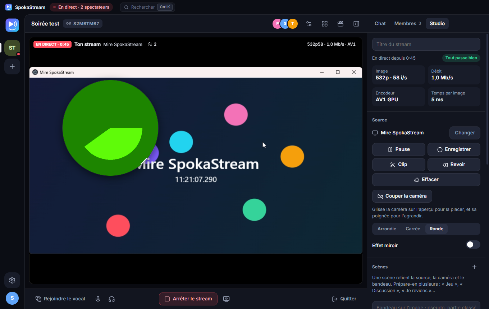
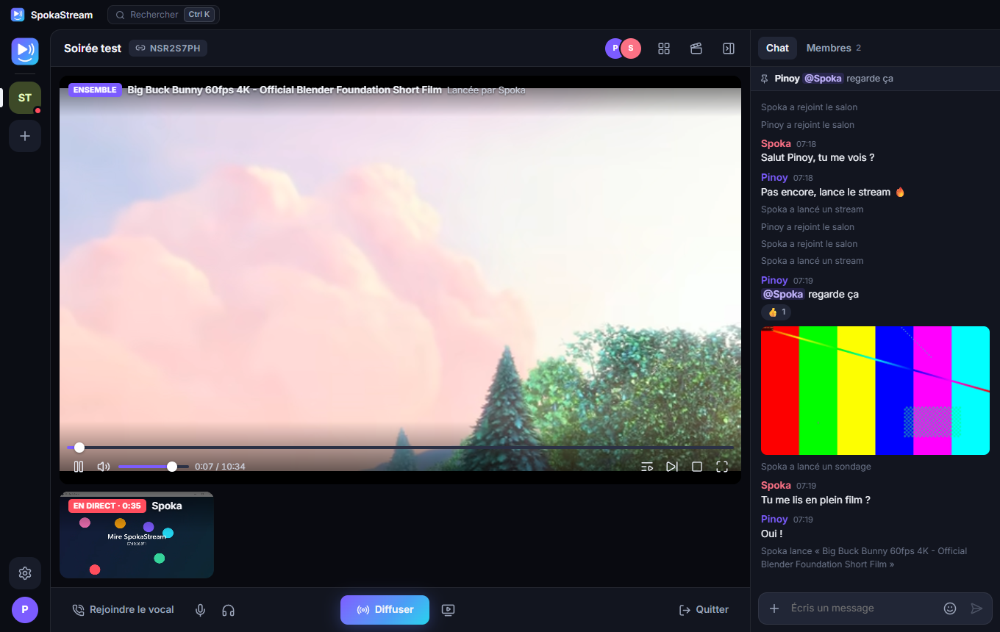
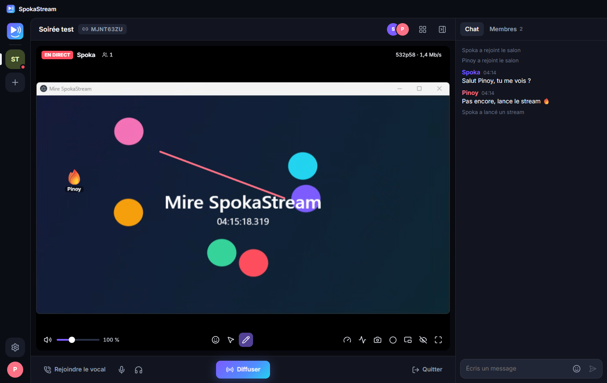
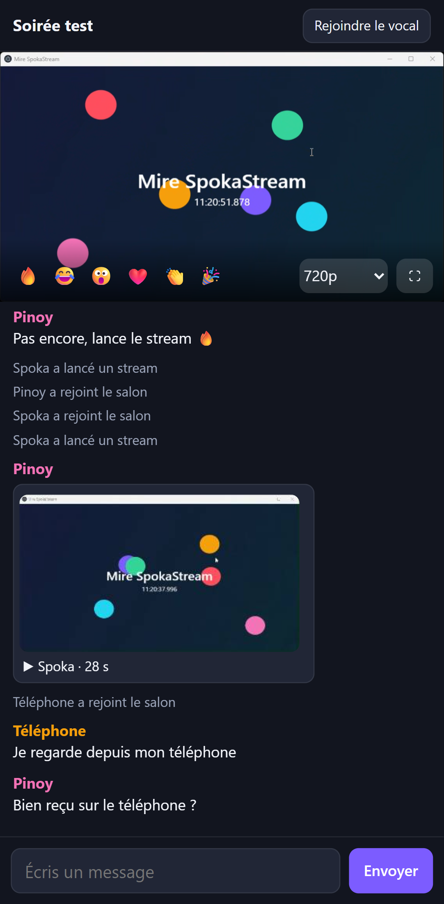

<div align="center">


# SpokaStream

**Stream entre amis, en vraie qualité, avec le son de ton choix.**

Tes amis regardent depuis l'application, ou juste en ouvrant le lien sur leur téléphone.

Un logiciel installé, pas une page web : il capte le son d'une application précise, reste dans la zone de notification, et envoie l'image directement de ton PC à ceux de tes amis.

%20%7C%2011-0078D6)
[](LICENSE)

**[Télécharger l'installeur](https://github.com/Spokator/SpokaStream/releases/latest)**



</div>

## Pourquoi un logiciel et pas une page web

La watch party de PinoyBot a montré sa limite : un navigateur sait capter un onglet ou tout le PC, jamais une application. Partager un jeu envoyait donc aussi Discord, et les voix revenaient en écho. Seul un logiciel installé a accès à l'API Windows de capture par processus. SpokaStream l'utilise, et récupère au passage tout ce que la party avait appris sur la qualité.

## Ce que ça fait

| | |
| --- | --- |
| 🔊 **Le son que tu veux** | Une application, plusieurs, ou tout le PC **sauf SpokaStream** : plus d'écho. Partage une fenêtre et son son est choisi tout seul. Table de mixage en direct, avec un volume et un niveau par source. |
| 🎬 **Toutes les sources** | Écran, fenêtre, caméra ou carte d'acquisition, fichier vidéo de ton PC, et **OBS** avec ses scènes et son mix. Changement de source en plein direct, sans couper. |
| 🎛️ **Ton stream, ta régie** | Scènes en un clic, caméra placée où tu veux sur l'image, bandeau de texte, table de mixage. |
| 📱 **Sans rien installer** | Le lien d'invitation s'ouvre dans un navigateur, téléphone compris : image, son, chat, sondages, clips, vocal. |
| 🎮 **Prendre la main** | Un ami joue à ta place depuis chez lui, avec ton accord, dans la seule fenêtre partagée. Tu la reprends d'une touche. |
| ⚡ **La meilleure image** | Capture native à 60 i/s et plus, là où un navigateur plafonne à 48 sur un écran 144 Hz. Mesure réelle des encodeurs de ta machine, puis choix du codec le plus efficace qui tient la cadence : AV1, H265 ou H264, sur la carte graphique. Débit et cadence réglables à chaud. |
| 👥 **Streamer à plusieurs** | Chacun peut diffuser en même temps. Vignettes en direct, grille ou grand écran. Personne ne regarde ? Rien n'est encodé. |
| 🎚️ **Chaque spectateur choisit** | Qualité pour lui seul, son seul pour économiser, volume jusqu'à 300 %, latence ultra faible ou stable. |
| 📺 **Regarder ensemble** | Colle un lien YouTube : chacun lit la vidéo chez lui en pleine qualité, et tout le salon reste synchronisé, pause et file d'attente comprises. |
| ✏️ **Interagir** | Chat avec réactions, mentions, images et message épinglé, sondages en direct, pointeur laser et dessin sur le stream. Le diffuseur voit tout sur son écran grâce à l'overlay, que les spectateurs ne voient pas en double. |
| ✂️ **Revoir et clips** | Rejoue les 30 dernières secondes, coupe à la seconde près, garde un MP4 ou envoie-le au salon de PC à PC. |
| 📌 **Pratique** | Mode cinéma avec le chat sur l'image, zoom dans le stream, bulle caméra, fenêtre flottante toujours au-dessus, capture d'écran, enregistrement en `.mkv`, statistiques détaillées, recherche Ctrl+K. |
| 🎙️ **Vocal intégré** | Micro ouvert ou appuyer pour parler, même en jeu, réduction du bruit, volume par personne. Le micro reste séparé du son du stream. |
| 🖥️ **Un vrai logiciel Windows** | Zone de notification, lancement avec Windows, raccourcis globaux, notifications quand un ami passe en direct, mises à jour automatiques, liens d'invitation. |
| 🔒 **Privé** | Pas de compte. La vidéo, le son et les clips vont de PC à PC : le serveur ne les voit jamais. Pause qui coupe vraiment l'image et le son. |

<div align="center">
 
<br />

</div>

## Installation

Télécharge **`SpokaStream-Setup-x.y.z.exe`** depuis les [releases](https://github.com/Spokator/SpokaStream/releases/latest). Aucun droit administrateur ni .NET n'est nécessaire.

> Windows peut afficher « Windows a protégé votre ordinateur », car le logiciel n'est pas signé : *Informations complémentaires* → *Exécuter quand même*.

## Comment ça marche

```
        ┌─ serveur de salons ─┐   présente les participants, transporte le chat
        │ (quelques ko/s)     │   ne voit jamais la vidéo
        └──▲───────────────▲──┘
           │               │
   ┌───────┴──────┐  WebRTC direct  ┌──────────────┐
   │  Diffuseur   ├────────────────►│  Spectateur  │
   │              │  (relais TURN   │              │
   │ SpokaAudio ──┤   si le réseau  │              │
   │  (WASAPI)    │   le bloque)    │              │
   └──────────────┘                 └──────────────┘
```

Le détail des choix et des mesures est dans [docs/ARCHITECTURE.md](docs/ARCHITECTURE.md).

**À savoir** : chaque spectateur a son propre encodage. C'est ce qui permet une qualité par personne, mais un stream à 12 Mb/s pour 4 spectateurs demande 48 Mb/s d'envoi. La fenêtre de lancement affiche ce total avant de démarrer, et on peut limiter le nombre de spectateurs.

## Diffuser depuis OBS

OBS 30 ou plus récent. Dans **Lancer un stream**, ouvre l'onglet **OBS** et copie l'adresse et le jeton :

1. OBS → Paramètres → Stream : service **WHIP**, colle le serveur et le jeton Bearer.
2. OBS → Paramètres → Sortie : un débit généreux, 20 000 kb/s par exemple. Tout reste sur ton PC.
3. **Démarrer le streaming** dans OBS, puis **Lancer le stream** dans SpokaStream.

Change de scène dans OBS, tes spectateurs suivent. OBS doit tourner sur le même PC que SpokaStream.

## Prendre la main

Rien ne passe sans ton accord, et tu reprends la main à tout moment avec Ctrl+Alt+A, le Studio ou la zone de notification. Le moteur natif impose ces limites, quoi qu'envoie l'autre côté :

- Ses gestes n'arrivent que dans la fenêtre partagée : si tu en sors, ils sont ignorés.
- La touche Windows, Alt+F4, Alt+Tab et les raccourcis de SpokaStream ne passent pas.
- Si la connexion se fige, tout ce qu'il tenait enfoncé est relâché.
- Partager un écran entier lui donne tout l'écran : l'application te prévient, et l'accord se donne alors uniquement dans la fenêtre, jamais au clavier.

Clavier et souris uniquement : une manette n'est pas transmise. Certains jeux avec anti-triche refusent les touches simulées, et les fenêtres lancées en administrateur restent hors d'atteinte.

## Sans serveur

Paramètres → Serveur → **Héberger sur ce PC** : tout fonctionne en réseau local, sans rien installer d'autre.

## Développement

Prérequis : Windows 10/11, Node.js 22, SDK .NET 9.

```powershell
npm install         # construit aussi le lecteur web
npm run native      # compile le moteur audio
npm run server      # serveur de salons en local, port 8787
$env:SPOKASTREAM_SERVER = "ws://127.0.0.1:8787/ws"; npm run dev
```

```powershell
npm run typecheck
npm test            # serveur, SDP, choix du codec, tampon audio
npm run test:e2e    # parcours complet : deux instances, WebRTC réel, son réel
npm run test:production   # le vrai serveur, vidéo forcée par le relais
npm run test:obs    # le vrai OBS, dans une copie isolée
```

Le parcours complet diffuse une mire de test, jamais ton écran. Il joue un son faible pendant environ deux minutes.

| Dossier | Contenu |
| --- | --- |
| `src/main` | Processus principal : fenêtres, zone de notification, overlay, moteur audio, mises à jour |
| `src/renderer/src/engine` | Cœur : signalisation, publication, réception, voix, mixage, encodeurs |
| `src/renderer/src/views` | Interface React |
| `src/shared` | Protocole et contrat entre processus |
| `server` | Serveur de salons, autonome, aussi embarqué dans l'application |
| `web` | Lecteur web, servi par le serveur de salons |
| `native/SpokaAudio` | Moteur natif C# : son par application, capture d'image, touches globales |
| `deploy` | Installation du serveur sur un VPS |

## Publier une version

1. Mets à jour `version` dans `package.json` et le [journal des versions](CHANGELOG.md).
2. `git tag vX.Y.Z && git push --tags`

Le workflow GitHub construit l'installeur et le publie : les applications installées se mettent à jour toutes seules.

## Déployer le serveur

Voir [docs/ARCHITECTURE.md](docs/ARCHITECTURE.md#déploiement). Il peut utiliser le coturn déjà en place pour PinoyBot.

## Licence

[MIT](LICENSE) © 2026 Spokator
